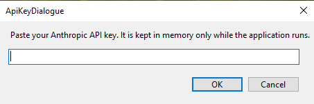
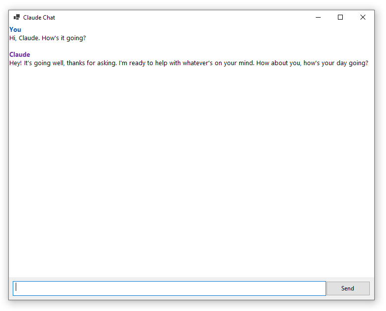

# WinForms Chatbot
 
A simple Windows desktop app for chatting with Claude through the Claude API.

The purpose of this project is to learn about how to use the Windows/.NET APIs using C# (such as WinForms which is used for the UI) and also to see how the Claude API works.



 
## Requirements
 
- Windows
- Visual Studio (with the .NET desktop development workload)
- A Claude API key

## Getting started
 
1. Clone the repository:
```
   git clone https://github.com/Inkythunder/ClaudeChat.git
```
2. Open the solution (`.sln`) in Visual Studio.
3. Press **F5** to build and run.
## Usage
 
1. Paste your API key into the key field.
2. Type a message and send it. Claude's reply appears in the chat window.
